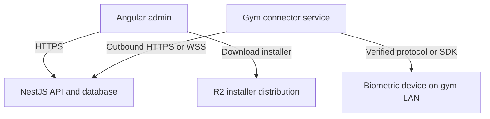

# Zenvore Biometric Connector — Implementation Handoff

Date: 19 October 2026
Status: proposed implementation specification agreed through discussion; no connector or device integration has been implemented or verified by this document.

## 1. Goal and project boundaries

Build a lightweight, downloadable local connector that bridges biometric devices on a gym LAN with the existing Zenvore cloud application.

- New project: `zenvore-biometric-connector`, initially Python and Windows first.
- Existing Angular admin: setup wizard, device management, health, manual sync, access controls.
- Existing NestJS backend: pairing, connector authentication, commands, attendance ingestion, monitoring and permissions.
- R2: distribution of versioned installers. R2 is not the connector runtime or command server.
- Mac support: separate build and service integration, only for adapters compatible with macOS. Do not promise compatibility based on TCP alone.

The common connector can support many device adapters. There is no verified universal device protocol. Model, firmware, protocol documentation and physical testing determine compatibility.

## 2. Architecture



Cloud NestJS cannot directly address a gym private IP. Angular sends management requests to NestJS; the connector performs LAN operations. No router port forwarding is required. Closing the browser does not stop the service. Shutting down or sleeping the computer stops connectivity.

## 3. Agreed behaviour and proposed defaults

| Item | Behaviour |
|---|---|
| Installation | Installer configures an automatically starting background service |
| Interface | Small pairing/setup utility; ongoing management in Angular |
| Attendance | Scheduled fetch approximately every 60 seconds |
| Health | Heartbeat approximately every 60 seconds, including when no scans occur |
| Offline threshold | Proposed: three missed heartbeats; configurable grace period |
| Manual run | Sync now starts promptly if connected; no overlapping device syncs |
| Network requirement | Cloud connectivity required for normal syncing; no standalone offline management mode |
| Reconnection | Obtain fresh access token, reconnect, reconcile access state and catch up attendance |
| Compatibility | Report attendance and access capabilities separately |

Minimal durable local state for recovery is still required. Requiring internet does not remove the need to preserve sync markers, pending uploads and credentials across crashes.

## 4. Installation and setup wizard

1. Authorized owner or staff selects the gym in Angular.
2. Page offers the supported Windows installer from a versioned R2 download URL.
3. Installer requests required installation permissions, installs the service and setup utility, and configures automatic startup and restart on failure.
4. Angular generates a short-lived single-use pairing code scoped to the selected gym.
5. Owner enters the code in the local setup utility.
6. Connector pairs with NestJS and securely stores its installation credential.
7. Connector identifies available LAN interfaces and performs bounded discovery of supported device protocols.
8. User confirms the intended device; if necessary enters its IP, port and device-specific credentials manually.
9. Connector saves verified device settings and reports capabilities.
10. User tests connectivity and runs an initial attendance sync.

Show independent results: **Connector connected to Zenvore**, **Biometric device connected**, **Attendance sync successful**. Authentication alone must never mark the physical device connected. A successful fetch with zero new records is a successful sync.

If no supported device is found, offer manual configuration and a support request. Support submission must be explicit and include only relevant diagnostics, with credentials excluded.

## 5. Network checks and discovery

Check separately: a usable LAN interface, device reachability, and HTTPS reachability of the Zenvore API. Wi-Fi association does not prove internet access; internet access does not prove device reachability. Report DNS, TLS, authentication and server failures distinctly when possible.

- Try saved device settings first on subsequent starts.
- Discover on user-selected local interfaces/subnets; avoid VPN and virtual interfaces by default.
- Bound subnet size, concurrency and timeouts. Start with supported device ports and vendor discovery methods rather than all ports on every possible address.
- Support TCP and UDP only where documented by the adapter; a TCP-only scan cannot discover all protocols.
- An open port is a candidate, not proof of device identity or protocol support.
- Perform a documented, non-destructive handshake and obtain stable device identity where supported.
- Do not activate, deactivate, enroll or clear logs during discovery.
- Where multiple devices are found, require device selection rather than binding the first response.
- Detect IP changes using saved identity and rediscovery; recommend a DHCP reservation during installation.
- Never send device passwords to ordinary logs or diagnostics.

## 6. Authentication and gym isolation

### Pairing

An authenticated and authorized Angular user requests a code for a gym. Proposed validity: five minutes. Code redemption is rate limited and atomic: at most one connector can consume it. Store a verifier rather than plaintext where feasible. Expired, consumed or revoked codes fail. Never use a gym-wide secret embedded in the installer.

Successful redemption creates a unique connector identity with a gym assignment and a separately generated installation credential. Store the credential using Windows-protected storage appropriate to the service account. The setup utility and service must use a deliberate, restricted handoff so a credential saved under an interactive user is actually available to the service.

### Ongoing authentication

The connector exchanges its installation credential for a short-lived access JWT at a NestJS token endpoint. Proposed JWT lifetime: 15 minutes. Fetch a new token before expiry; after restart, fetch a fresh token instead of requiring pairing again. This may be implemented using OAuth 2.0 client credentials if the existing auth infrastructure supports it; a custom pairing exchange must not be represented as a standardized OAuth flow by default.

- Validate TLS certificates; never disable certificate verification.
- Scope access to the connector's authenticated tenant, gym and assigned devices.
- Validate issuer, audience, expiry, signature and permitted algorithms for JWTs.
- Keep installation credentials out of Angular storage, URLs, installers and logs.
- Store only an appropriate credential verifier server-side for secret-based authentication.
- Support rotation, revocation and re-pairing; normal rotation must not require routine owner intervention.
- Reject revoked connectors on protected operations, including before JWT expiry if immediate revocation is promised.
- Disconnect revoked persistent sessions and stop dispatching commands to them.
- Rate limit pairing, token requests, uploads and manual actions.

NestJS derives the gym from authenticated connector identity. It must never authorize access from a caller-supplied gym ID alone. Connector credentials cannot create arbitrary members or exercise full owner permissions.

## 7. Command delivery

Use one outbound authenticated WSS connection for prompt commands if practical. HTTPS long polling is an alternative. Keep attendance polling independent of command delivery. A connector that checks commands only once per minute cannot promise immediate manual sync.

Persist commands in the backend database before notification. WSS is a delivery signal, not the durable queue. On reconnect the connector fetches eligible work even if notifications were lost.

Supported command families:

- `TEST_DEVICE_CONNECTION`
- `DISCOVER_DEVICES` — bounded, only when requested
- `SYNC_ATTENDANCE`
- `SET_MEMBER_ACCESS` — desired enabled state and state version

Each command has an ID, device assignment, creation time, status, lease/attempt data and result. Acknowledge receipt separately from actual device success. Use durable completion records and leases so a crash cannot leave work permanently stuck. Process device operations serially unless the adapter explicitly supports concurrency.

Proposed statuses: `pending`, `leased`, `running`, `succeeded`, `failed`, `superseded`, `expired`. Retry only bounded, classified transient failures. A timed-out device write may have applied; verify state before blindly repeating when possible.

## 8. Attendance syncing

1. Acquire the per-device sync lock.
2. Read the last durable sync position.
3. Fetch new records using the device's supported cursor or record index.
4. Where incremental queries are unavailable, use a bounded overlapping read and deduplication.
5. Normalize identifiers and timestamps; preserve original device values where needed for troubleshooting.
6. Persist pending batches locally before upload when loss could otherwise occur.
7. Upload bounded batches to NestJS with deterministic event identities.
8. NestJS validates gym/device ownership, inserts idempotently and acknowledges committed results.
9. Advance the cloud-acknowledged position only after acknowledgement; retain unacknowledged records for retry.

Deduplication should use a stable native record ID where available. Otherwise document the adapter-specific composite identity; member and timestamp alone can collide. Partition identity by tenant/gym and device, and handle device resets or record-ID reuse with an appropriate device generation.

Map device user IDs to Zenvore members explicitly. Unknown users go to an unresolved queue for mapping, rather than being silently discarded or assigned to a guessed member. Attendance data and door-access success are different facts; preserve event type where available.

Use UTC for cloud timestamps and retain configured device timezone and raw timestamp when the device provides local time. Handle clock drift and clock changes. First-time sync needs an explicit history range or starting policy to avoid importing an unlimited history unexpectedly.

Do not clear device attendance logs as part of normal syncing. Recovery depends on device retention and capacity. If history has been overwritten, report a data gap rather than claiming full recovery. Fingerprint templates are excluded from the attendance upload design.

## 9. Member activation and deactivation

NestJS owns the desired member access state. Each change increments a state version. The connector applies only the current applicable version and reports observed results. Older queued activations must not undo later cancellations. After a long outage, reconcile current desired state instead of blindly replaying every historical toggle.

Maintain a member-to-device-user mapping for each device. Enrollment, adding a device user, enabling attendance recognition and granting door access may be different operations. Advertise each capability accurately. A device without supported access controls cannot be made to enforce membership rules by cloud software alone.

Where supported and tested, sync membership expiry dates into the device for local expiry enforcement. Do not promise immediate cloud cancellation while the connector is offline. Physical exit and emergency mechanisms remain the responsibility of the installed access-control system; do not reinterpret deactivation as a generic door lock command.

## 10. Monitoring and shutdown

Heartbeat includes connector version, last successful device communication, last attendance fetch, last cloud-acknowledged upload, current operation, pending count and sanitized error code. Server receipt time determines connector freshness.

Display separate states:

- Connector online and device reachable.
- Connector online but device unreachable.
- Connector offline or cloud connection unavailable; exact cause unknown remotely.
- Sync running, caught up, delayed or failed.

No new attendance does not mean the device is offline. A successful device health request or attendance fetch proves recent communication even if it returns zero records.

Graceful shutdown may send a best-effort notification. Forced termination, laptop sleep, power loss or network failure cannot reliably send one. Missed heartbeats provide detection. Start the service on boot without requiring the owner to open Angular. On reconnection, recover state and send a fresh heartbeat. Suppress repeated alerts during the same outage.

## 11. Local storage and resource usage

Use a small durable store, such as SQLite, for configuration metadata, sync cursors, pending batches and command completion records. Store secrets separately with OS protection. Restrict file permissions to service/admin identities as appropriate.

Persist device IP, port, adapter identifier, stable identity, timezone and verified capabilities. Do not store unnecessary member profiles or fingerprint templates. Bound logs, retries, queue size and batch memory. Prune acknowledged temporary data under an explicit retention policy. Handle disk-full conditions without falsely acknowledging data.

Use an event loop or small worker pool, network timeouts and idle waits. No continuous LAN scanning. Measure actual installer size, idle RAM, CPU and sync duration before calling the application lightweight; no resource figures have been measured yet.

## 12. Proposed NestJS API surface

Paths below are design examples; adapt them to existing route conventions.

| Endpoint | Caller | Purpose |
|---|---|---|
| `POST /gyms/:gymId/biometric/pairing-codes` | Authorized admin user | Issue setup code |
| `POST /connectors/pair` | Unpaired connector with code | Redeem code and register installation |
| `POST /connectors/token` | Connector credential | Issue short-lived access token |
| `POST /connectors/me/heartbeat` | Connector JWT | Report health |
| `PUT /connectors/me/devices/:deviceId/report` | Assigned connector | Report discovery identity/capabilities/status |
| `GET /connectors/me/commands` | Connector JWT | Fetch or long-poll eligible commands |
| `POST /connectors/me/commands/:commandId/ack` | Assigned connector | Acknowledge receipt/start |
| `POST /connectors/me/commands/:commandId/result` | Assigned connector | Report durable completion |
| `POST /connectors/me/attendance/batches` | Connector JWT | Ingest events idempotently |
| `GET /gyms/:gymId/biometric/status` | Authorized admin user | Read health and sync status |
| `POST /gyms/:gymId/biometric/devices/:deviceId/sync` | Authorized admin user | Queue manual sync |
| `PUT /gyms/:gymId/biometric/devices/:deviceId/members/:memberId/access` | Authorized admin user | Change desired access |
| `POST /gyms/:gymId/biometric/connectors/:connectorId/revoke` | Authorized owner/admin | Revoke installation |
| `POST /gyms/:gymId/biometric/support-requests` | Authorized admin user | Explicitly request troubleshooting |

Return command IDs for asynchronous actions. Angular reads or subscribes to their results. Apply authorization, input validation, rate limits and audit logging at every boundary. Backend acknowledgements must represent committed work.

## 13. Proposed data entities

| Entity | Essential fields |
|---|---|
| Pairing code | verifier, gym/tenant, creator, expiry, consumption time |
| Connector | ID, gym/tenant, credential verifier/version, revoked time, app version, last heartbeat |
| Device | ID, assigned connector, gym, stable device identity, adapter, capabilities, last health |
| Member mapping | gym, device, device user ID, Zenvore member ID |
| Desired access | device/member, enabled, expiry if supported, state version, last confirmed version |
| Command | ID, connector/device, type, payload/version, status, lease, attempts, result |
| Sync checkpoint | device/generation, last acknowledged position, reconciliation details |
| Attendance | deterministic event identity, gym/device/member mapping, event time/type, ingestion time |
| Support request | gym/connector/device references, explicit requester, sanitized diagnostics, status |

Enforce unique constraints for event ingestion and mappings. Reject cross-gym device/member references. Support multiple devices deliberately; for v1 use one active connector responsible for each device to avoid competing writes.

## 14. Angular screens

- Biometric setup wizard with download, pairing, discovery, selection and test stages.
- Device list with connector and device health shown separately.
- Last contact, last successful fetch/upload, pending access changes and unresolved users.
- Sync now and test buttons with queued/running/success/failure feedback.
- Capability-aware member access controls; disable unavailable actions with a clear reason.
- Manual IP/port configuration and explicit support request.
- Revoke/re-pair flow with owner permissions.

Angular does not need direct LAN access. The local setup utility receives the pairing code; cloud status updates drive the web wizard. Opening the setup page automatically at installer completion is optional and must not claim successful setup before backend confirmation.

## 15. Suggested connector project structure

```text
zenvore-biometric-connector/
  pyproject.toml
  README.md
  src/zenvore_connector/
    main.py
    config.py
    service/
    setup_ui/
    auth/
    cloud/
    discovery/
    adapters/
      base.py
      simulator.py
    sync/
    commands/
    storage/
    health/
  tests/
  packaging/windows/
  packaging/macos/
  docs/
```

Adapter interface should expose identity, capability detection, health, attendance retrieval, user lookup and supported access-state operations. Unsupported operations return explicit errors. The simulator allows framework testing but must never be presented as verified hardware support.

## 16. Packaging and distribution

Build Windows packages on a Windows build environment with the appropriate Python/runtime and SDK architecture. Bundle runtime dependencies so gym owners need not install Python. Include vendor components only under their redistribution permissions. Deliver a proper installer and uninstaller, service configuration, version metadata and sanitized diagnostics export.

Publish immutable versioned installers to R2 over HTTPS. Never bundle gym credentials. Sign production installers where available and validate package integrity. Treat automatic updating as a separate controlled feature requiring authentic release verification, safe service restart and rollback; do not execute arbitrary downloaded scripts. Initial releases may use explicit installer upgrades.

Mac builds require their own packaging, startup service, secure storage and platform validation. A Windows-only SDK cannot be made portable merely by repackaging Python.

## 17. Implementation sequence

1. Establish common API contracts, entities, permissions and simulator adapter.
2. Implement pairing, credential lifecycle, heartbeat and authenticated command delivery.
3. Implement durable local state, attendance batches, deduplication and crash recovery against the simulator.
4. Implement Angular setup/status/manual sync screens.
5. Package and test the Windows service and setup utility.
6. Obtain protocol/SDK documentation and a physical device for the first real adapter.
7. Verify attendance and access capabilities independently; publish the exact tested model/firmware matrix.
8. Pilot in a gym, measure resources and recovery behaviour, then expand adapters.

## 18. Acceptance tests

- Install, pair once, reboot and resume without re-pairing or opening a browser.
- Reject expired/reused pairing codes, invalid credentials and cross-gym requests.
- Revoke an installation and enforce revocation on existing sessions and protected requests.
- Reject an unrelated open TCP service as a biometric device.
- Recover after device IP changes, network loss, computer restart and token expiry.
- Distinguish zero new scans from a disconnected device.
- Sync now starts promptly and cannot overlap another device sync.
- Retry an upload after a lost acknowledgement without duplicate attendance.
- Survive a crash between device fetch, local persistence, cloud commit and local acknowledgement.
- Keep older enable commands from overriding newer deactivation state.
- Report partial/unsupported operations accurately; never show cloud save as device success.
- Detect missing heartbeats without relying on a final shutdown API call.
- Catch up retained attendance after downtime and report overwritten-history gaps.
- Keep logs, credential handling and temporary data within defined bounds.

## 19. Open decisions before production

- First supported model, firmware, SDK/protocol and licensing.
- Whether access expiry and state read-back are supported on that model.
- WSS versus HTTPS long polling for command delivery.
- Initial attendance import range and device timezone configuration.
- Alert destinations, retention limits and measured resource targets.
- Scope of v1 device count and Mac compatibility.

These decisions do not block building the shared framework. Real hardware support, reliable door-access enforcement and cross-platform compatibility remain unverified until tested.

## 20. Instructions for the implementing developer

Implement this as one new local connector project plus targeted changes to existing Angular and NestJS projects. Inspect existing repository conventions, authentication and attendance schemas before changing them. Preserve tenant isolation. Build the simulator and common framework first; do not invent vendor commands or claim universal compatibility. Deliver runnable development instructions, example non-secret configuration, packaging steps, migration/API details and the results of meaningful integration and recovery tests. Clearly distinguish implemented framework behaviour from hardware capabilities still awaiting validation.
